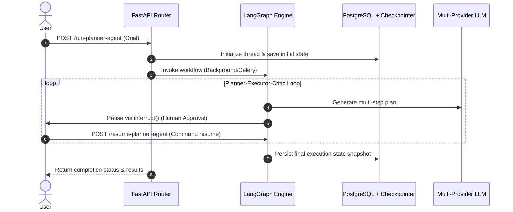
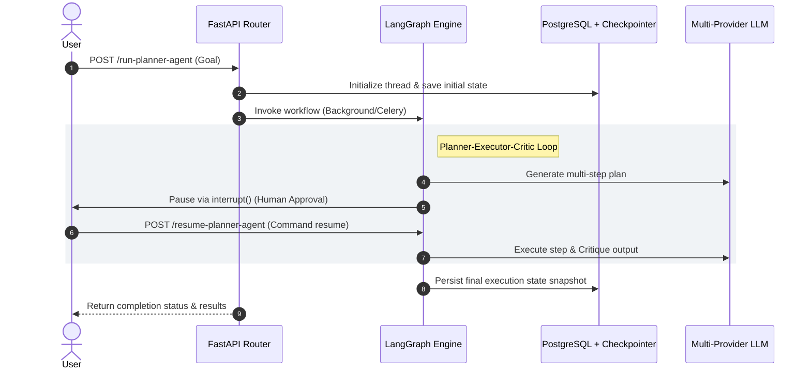

# 🏗️ Modular Multi-Agent FastAPI & LangGraph Architecture

## 1. System Overview
This project is a production-grade, multi-agent conversational and planning system built with **FastAPI**, **LangGraph**, **PostgreSQL (pgvector)**, and **Celery/Redis**. It implements two major agentic paradigms:
1. **Master-Worker Routing:** A coordinator model dynamically routes user intents to specialized worker nodes (`country_worker`, `politics_worker`, `rag_worker`).
2. **Planner-Executor-Critic Workflow:** A multi-step goal decomposition loop featuring human-in-the-loop approval, iterative quality control critique, and automated scoring.

---

## 2. Core Tech Stack & Infrastructure
* **API Framework:** FastAPI (supporting both local `BackgroundTasks` and asynchronous Celery queues).
* **Orchestration:** LangGraph (`StateGraph`, `ToolNode`, `Command`, `interrupt`).
* **Database & Memory:** PostgreSQL with `pgvector` for semantic document retrieval and `PostgresSaver` for persistent thread checkpointing.
* **LLM Abstraction Layer:** Dynamic multi-provider factory supporting OpenAI and Google Gemini tiers.
* **Deployment:** Fully dockerized services (`web`, `celery_worker`, `postgres`, `redis`, `flower`).

---

## 3. Architecture & Execution Flow (Sequence Diagram)

---

### Step 2: How to Demonstrate This in Your Interviews

When interviewers ask about your project, structure your narrative using the **STAR method** (Situation, Task, Action, Result) and emphasize these key architectural highlights:

#### 1. Highlight Distributed State & Persistence (`PostgresSaver`)
* **The Interview Talking Point:** *"Instead of relying on in-memory storage like `MemorySaver` which drops state on server crashes, I implemented persistent checkporting using `langgraph-checkpoint-postgres`[cite: 6]. Every step, thread interruption, and multi-turn conversation is safely committed to PostgreSQL[cite: 6]. This allows human-in-the-loop workflows to pause indefinitely and resume seamlessly days later using thread IDs."*

#### 2. Discuss Dual Execution Engines (FastAPI vs. Celery)
* **The Interview Talking Point:** *"Agent workflows—especially multi-step planner loops—can take time. I designed a pluggable execution layer[cite: 6]. Users can choose lightweight asynchronous processing via FastAPI `BackgroundTasks` or offload heavy tasks to a distributed **Redis and Celery** worker cluster for production horizontal scaling[cite: 6, 8]. Results and errors are automatically broadcasted back via webhooks[cite: 6, 8]."*

#### 3. Explain Hybrid RAG & Vector Search
* **The Interview Talking Point:** *"For domain-specific knowledge, the system ingests curriculum documents on startup[cite: 11], chunks them using recursive splitting[cite: 7], embeds them[cite: 7], and stores them in PostgreSQL using the `pgvector` extension[cite: 10]. Worker nodes query this via cosine similarity distance searches to ground LLM outputs and eliminate hallucinations[cite: 1]."*

#### 4. Talk About Provider-Agnostic LLM Design
* **The Interview Talking Point:** *"To avoid vendor lock-in, I built a dynamic LLM factory (`get_llm`) that decouples reasoning and summarization tiers[cite: 3]. It instantiates either OpenAI or Google Gemini strictly through environment configurations (`REASONING_PROVIDER`) without hardcoded fallback logic[cite: 3]."*

By keeping your `ARCHITECTURE.md` in your repository and practicing these talking points, you'll sound like a senior systems architect who deeply understands both agentic workflows and production backend engineering!    

# 🤖 System Context & Architecture Prompt: Multi-Agent FastAPI & LangGraph Backend

You are acting as an expert AI collaborator and senior software architect reviewing and extending a production-grade multi-agent backend. Here is the complete context of the project architecture, tech stack, and state management implemented so far.

---

## 1. Project Overview & Core Architecture
* **API Framework:** FastAPI, featuring modular routers (`chat.py`, `planner.py`), background tasks, and webhook delivery.
* **Orchestration Engine:** LangGraph (`StateGraph`, `ToolNode`, `Command`, `interrupt`), managing two distinct agentic paradigms:
  1. **Master-Worker Routing (`master_graph.py`):** Dynamically inspects user prompts using a reasoning LLM tier and routes requests to specialized workers (`country_worker`, `politics_worker`, `rag_worker`).
  2. **Planner-Executor-Critic Workflow (`planner_graph.py`):** Breaks user goals into sequential steps, executes them iteratively, uses a strict critic node for quality control, grades outputs via an evaluation node, and features **Human-in-the-Loop** approval using `interrupt()` and `Command(resume=...)`.
* **Database & Vector Search:** PostgreSQL equipped with the `pgvector` extension (`document_chunks` table holding 3072-dimensional embeddings for RAG) and SQLAlchemy models (`chat_sessions`).
* **Persistent Checkpointing:** Backed by `PostgresSaver` with `autocommit=True` (`langgraph-checkpoint-postgres`), ensuring conversation states and multi-turn threads survive server restarts.
* **Dual Execution Engines:** Supports local FastAPI `BackgroundTasks` or asynchronous offloading to a distributed **Redis & Celery** worker cluster (`celery_app.py`).
* **Dynamic Multi-Provider LLM Factory (`core/llm.py`):** Decouples reasoning and summarization tiers, dynamically initializing OpenAI (`ChatOpenAI`) or Google Gemini (`ChatGoogleGenerativeAI`) strictly via environment variables (`REASONING_PROVIDER`, `SUMMARIZATION_PROVIDER`) without hardcoded fallbacks.

---

## 2. Complete File Structure & Modules
* **`app/config.py`**: Handles environment variables, multi-provider validation, and dynamic test/docker database host switching (`localhost` for `pytest`, `db` for Docker network).
* **`app/database.py`**: Configures SQLAlchemy engine, `SessionLocal`, base models, and automatically initializes `CREATE EXTENSION IF NOT EXISTS vector;` on startup.
* **`app/main.py`**: FastAPI entrypoint; handles table creation, automatic startup PDF ingestion (`rag_service.py`), and registers routers.
* **`app/core/llm.py`**: Dynamic multi-provider factory (`get_llm`).
* **`app/models/documents.py`**: SQLAlchemy model for vector chunks (`DocumentChunkModel`).
* **`app/models/chat.py`**: SQLAlchemy model for historical chat session threads (`ChatSessionModel`).
* **`app/agents/tools.py`**: Contains the vector similarity search tool (`search_internal_docs`) and utility tools.
* **`app/agents/workers.py`**: Defines the shared `AgentState` TypedDict schema and compiles individual worker graphs using `ToolNode` and `MemorySaver`.
* **`app/agents/master_graph.py`**: Implements the master router logic and sub-thread isolation for workers.
* **`app/agents/planner_graph.py`**: Implements the multi-step Planner-Executor-Critic workflow, human approval interrupt, and evaluation grading.
* **`app/routers/planner.py`**: Manages API endpoints `/run-planner-agent` and `/resume-planner-agent` using PostgreSQL checkpointers and pluggable background/celery routing.
* **`app/routers/chat.py`**: Handles chat routing endpoints.
* **`app/services/rag_service.py`**: Ingests PDFs, chunks text using `RecursiveCharacterTextSplitter`, creates embeddings, and saves them to PostgreSQL.
* **`app/celery_app.py`**: Celery background execution counterpart for running planner graphs asynchronously via Redis.

---

## 3. Architecture Sequence Flow

